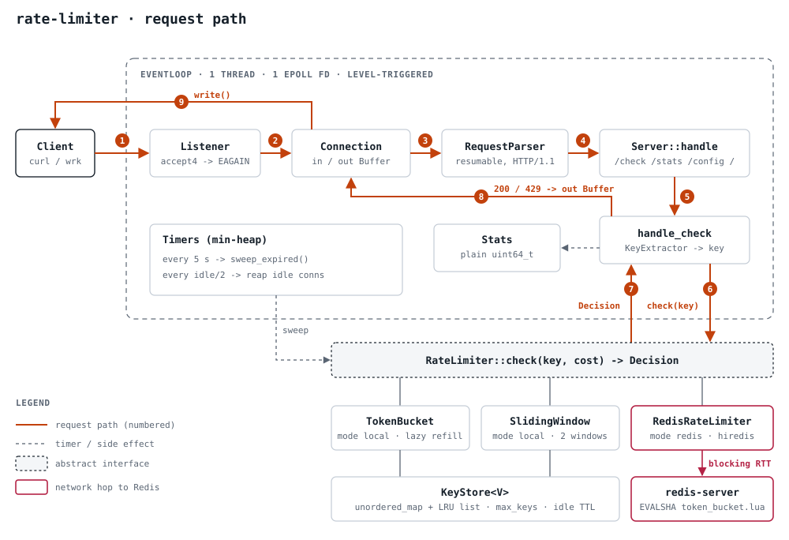

# Rate-Limiter

A from-scratch rate limiting service in C++20: a reusable core library, a
hand-written HTTP/1.1 front end, and Redis-backed distributed limiting for
multi-instance deployments. No frameworks in the core — the epoll event loop
and the HTTP parser are written by hand. Third-party libraries are limited to
`nlohmann/json`, `Catch2`, and `hiredis`.

Portfolio project: every design decision, with the alternatives that were
rejected and why, is recorded in [`docs/design.md`](docs/design.md).

---

## What it does

`GET /check?key=<k>` returns `200` if `<k>` is under its limit, `429` with a
`Retry-After` header if not. The limit is enforced by one of:

| algorithm | where the state lives | use |
|---|---|---|
| **token bucket** | in-process, per key | single node, smooth burst allowance |
| **sliding window counter** | in-process, per key | single node, no boundary burst |
| **token bucket in Redis (Lua)** | Redis hash, per key | many nodes sharing one limit |

---

## Architecture



One request, numbered 1–9: the `Listener` accepts, the `Connection` buffers
bytes, `RequestParser` builds a `Request`, `Server::handle` routes `/check`,
`KeyExtractor` picks the key, `RateLimiter::check` returns a `Decision`, and
the `200`/`429` goes back out through the connection's out buffer. Everything
in the dashed frame is one `EventLoop` on one thread. (PNG version:
[`docs/images/architecture.png`](docs/images/architecture.png).)

### Threads

`server.threads` (or `--threads N`, default 1) runs **N copies of that frame**,
one per thread, each with its own epoll loop and its own listening socket.
The sockets share the port through `SO_REUSEPORT`, so the kernel spreads
incoming *connections* across threads. It spreads connections, not *keys*:
`user-42` can arrive on any thread, so in local mode all threads share one
**`ShardedLimiter`** — 64 lock stripes, each a `std::mutex` around an ordinary
single-threaded limiter, picked by `hash(key) % 64`. Requests for one key
always meet the same lock and bucket; different keys mostly run in parallel.
In `redis` mode each thread gets its own `RedisRateLimiter` (a hiredis
connection is not thread-safe) and Redis holds the shared state. `/stats`
counters are relaxed atomics shared by every thread.

With `threads: 1` the service is exactly the original single reactor
(`docs/design.md` §0.1); the threading design and the alternatives it beat
are in §0.20.

### Source layout

```
src/core/    clock (injectable), config (JSON + CLI), stats counters, error category
src/limit/   RateLimiter interface, KeyStore (bounded LRU), TokenBucket, SlidingWindow,
             ShardedLimiter (lock-striped, shared by worker threads), KeyExtractor
src/net/     Fd RAII, Buffer, EventLoop (epoll), Listener, Connection
src/http/    Request, RequestParser, Response, Server (routing)
src/redis/   RedisClient (hiredis + reconnect/backoff), RedisRateLimiter, token_bucket.lua
tests/       Catch2 unit tests, mirrors src/
bench/       wrk scripts (run.sh profiles; run.sh scaling for threads = 1, 2, 4)
docs/        design log, architecture diagram
```

---

## Build

Requires GCC 13+, CMake 3.24+, Ninja. Dependencies are fetched and pinned by
CMake (`FetchContent`), or picked up from the system if a compatible version is
installed.

```sh
cmake --preset debug      # Debug, ASan + UBSan
cmake --build --preset debug
ctest --preset debug      # 53 unit tests

cmake --preset tsan       # Debug, ThreadSanitizer (can't share a binary with ASan)
cmake --build --preset tsan
ctest --preset tsan       # same 53 tests, checked for data races

cmake --preset release    # -O3, LTO
cmake --build --preset release
```

The `tsan` test binary runs under `setarch -R` (ASLR off for that process):
GCC 13's TSan runtime aborts with "unexpected memory mapping" on kernels with
`vm.mmap_rnd_bits = 32`. This needs no root and is wired up in CMake.

## Run

```sh
./build/release/ratelimiter --config config/ratelimiter.example.json
```

CLI overrides: `--config <path>`, `--listen <host:port>`, `--mode local|redis`,
`--redis <host:port>`, `--threads <n>` (1–256).

```sh
# 4 worker threads sharing one port and one limiter
./build/release/ratelimiter --listen 127.0.0.1:8080 --threads 4
```

```sh
# local token bucket, 5 rps burst 10, key from ?key=
./build/release/ratelimiter --listen 127.0.0.1:8080

curl -i 'http://127.0.0.1:8080/check?key=user-42'
#   HTTP/1.1 200 OK
#   X-RateLimit-Limit: 10
#   X-RateLimit-Remaining: 9
#   {"allowed":true,"limit":10,"remaining":9,"reset_ms":200}

# ... once the bucket is empty:
#   HTTP/1.1 429 Too Many Requests
#   Retry-After: 1
#   {"allowed":false,"limit":10,"remaining":0,"reset_ms":2000,"retry_after_ms":200}
```

### Distributed mode

```sh
redis-server --port 6379 &
./build/release/ratelimiter --mode redis --redis 127.0.0.1:6379 --listen 127.0.0.1:8081 &
./build/release/ratelimiter --mode redis --redis 127.0.0.1:6379 --listen 127.0.0.1:8082 &
# both instances now enforce one shared bucket per key
```

Redis mode is token-bucket only; `limiter.algo: sliding_window` with
`mode: redis` is rejected at startup.

---

## HTTP API

| route | method | response |
|---|---|---|
| `/` , `/dashboard` | GET | a self-contained HTML status page (see below) |
| `/check` | GET, HEAD | `200` / `429` + JSON `{allowed, limit, remaining, reset_ms[, retry_after_ms]}`; headers `X-RateLimit-Limit`, `X-RateLimit-Remaining`, and `Retry-After` (seconds) on `429` |
| `/healthz` | GET | `200 ok` |
| `/stats` | GET | JSON counters: requests, allowed, denied, bad_requests, config_changes, conns, key_count, evictions, sweeps_removed, redis_errors, redis_failopen/failclosed, uptime_ms |
| `/config` | GET | JSON of the limiter config in effect: `{algo, rate, burst, limit, window_ms}` |
| `/config` | POST | change the limiter live (local mode only). Params in the **query string**: `algo`, `rate`, `burst`, `limit`, `window_ms` — any subset; omitted fields keep their current value. `200` + the new config on success, `400` on a bad/out-of-range value, `409` in `redis` mode or when `server.threads > 1` |

### Status page

Open `http://<host>:<port>/` in a browser. It is served straight from the
`ratelimiter` process (no framework, no external requests), polls `/stats` once
a second, shows the live counters and a derived requests/sec, has a small
form to fire `/check?key=` calls so you can watch `200` turn into `429`, and a
panel that switches the algorithm and its parameters live via `POST /config`.

`POST /config` rebuilds the limiter from an empty key store, so existing
buckets/windows are cleared; the `/stats` counters keep running. Example:

```
curl -X POST 'http://127.0.0.1:8080/config?algo=sliding_window&limit=10&window_ms=10000'
curl -X POST 'http://127.0.0.1:8080/config?algo=token_bucket&rate=1&burst=5'
```

Key source is configurable (`key_extractor.source`): `query` (`?key=`),
`header` (a named header), or `ip` (peer address, or the left-most
`X-Forwarded-For` entry when `trust_forwarded_for` is set).

---

## Configuration

See [`config/ratelimiter.example.json`](config/ratelimiter.example.json).
Blocks: `server` (including `threads`), `limiter` (`algo`, `rate`, `burst`, `limit`, `window_ms`),
`key_store` (`max_keys`, `idle_ttl_ms`, `sweep_interval_ms`), `key_extractor`,
`redis` (`timeout_ms`, `fail_closed`, `connect_backoff_ms`).

---

## Design decisions (summary)

Full log with rejected alternatives in [`docs/design.md`](docs/design.md).

- **One reactor per thread.** Each worker thread runs its own epoll loop and
  `SO_REUSEPORT` listener; with `threads: 1` that is the original lock-free
  single reactor.
- **Lock striping for the shared limiter.** The kernel spreads connections,
  not keys, so threads must share per-key state. 64 mutex-guarded stripes
  (`hash(key) % 64`) instead of one global mutex; private per-thread limiters
  would let a key through N times its limit.
- **Relaxed atomics for counters.** `fetch_add(relaxed)` never loses an
  increment; no counter is used to publish other data, so no stronger
  ordering is needed.
- **Lazy refill / lazy decay.** State carries a timestamp; elapsed time is
  folded in on each `check()`. No timer per key — O(1) per request, idle keys
  cost nothing.
- **Sliding-window counter, not a log.** A per-key timestamp log is exact but
  its memory grows with the limit and with traffic — a DoS vector. The
  two-window weighted counter removes the fixed-window 2× boundary burst for
  one multiply, with a bounded approximation error (below).
- **Bounded key store.** `unordered_map` + intrusive LRU; evict LRU past
  `max_keys`, plus an idle-TTL sweep from the loop timer. An unbounded map
  lets an attacker vary the key and drive the process OOM.
- **Redis atomicity via one Lua script.** `GET` then `SET` from the client is a
  read-modify-write race between instances; the whole bucket update runs as one
  `EVALSHA` (with `SCRIPT LOAD`/`EVAL` fallback on `NOSCRIPT`). The script is
  deterministic — time is passed in as an argument, not read via
  `redis.call('TIME')` — so it is replication- and AOF-safe.
- **Fail open by default.** If Redis is unreachable the limiter allows the
  request and bumps `redis_failopen`; `redis.fail_closed` flips this. For a
  limiter, availability of the protected service usually outweighs a brief
  window of over-admission.
- **Errors are values on the hot path.** `std::error_code` with a project
  `error_category`; exceptions only during startup.

### Sliding-window approximation error

The estimate assumes requests in the previous window were uniformly
distributed. If the previous window's hits were actually clustered at its end,
the estimate under-counts and the limiter admits slightly more than the true
rolling count; if clustered at the start, it over-counts and admits slightly
fewer. The error is bounded by `prev_count` and shrinks linearly to zero across
the current window. For steady traffic it is negligible; token bucket is the
better choice when exactness at the edge matters.

---

## Benchmarks

Method: release build (`-O3`, LTO), server on loopback on one machine (6.8
kernel, GCC 13). Load from `wrk` on the same host, so numbers
are dominated by loopback syscall cost and the client competing for cores —
treat them as a lower bound and a regression baseline, not a datasheet figure.
Reproduce with `bench/run.sh` (single thread) and `bench/run.sh scaling`
(threads = 1, 2, 4).

### Thread scaling

AMD Ryzen 5 5600H (6 cores / 12 hardware threads), `wrk -t4 -c128 -d10s`,
generous limits, all rows from one session so they compare with each other.
Redis mode against a local `redis-server` 7.0.

| profile | threads = 1 | threads = 2 | threads = 4 | 4 vs 1 |
|---|---:|---:|---:|---:|
| `/healthz` | 134,131 req/s | 266,555 req/s | 403,933 req/s | 3.0× |
| `/check`, 2000 keys | 111,589 req/s | 210,955 req/s | 300,051 req/s | 2.7× |
| `/check`, 1 hot key | 107,957 req/s | 209,379 req/s | 307,677 req/s | 2.9× |
| `/check`, redis mode, 2000 keys | 21,005 req/s | 39,968 req/s | 57,239 req/s | 2.7× |
| `/check` 2000 keys, p50 / p99 | 1.11 / 2.20 ms | 0.56 / 1.17 ms | 0.27 / 0.70 ms | |

What the numbers say:

- **Near-linear to 2 threads (1.9×), sub-linear to 4 (2.7×).** At 4 threads
  the server is CPU-bound (3.83 of 4 threads busy during the run), so `wrk` is
  not what limits it; `wrk -t6` adds only ~11% and `-t8` is *slower*. Each
  thread does ~30% less work at 4 threads than the single thread did. Likely
  reasons, not measured one by one: 4 server + 4 `wrk` threads exceed the 6
  physical cores, so some share a core through SMT; a laptop CPU boosts lower
  with more cores busy; the kernel's loopback TCP work grows with throughput;
  and every thread writes the same shared counter cache lines.
- **The hot key keeps up with 2000 keys.** All 4 threads hammering one key
  means one stripe lock takes every request, yet throughput matches the
  spread-out profile. The critical section is a hash lookup and some
  arithmetic, tens of nanoseconds, against microseconds of syscalls and
  parsing per request; the lock is held for a few percent of the time, so it
  is not the bottleneck at this scale.
- **Redis mode scales too**, for a different reason: each thread blocks on its
  own Redis round trip, so N threads keep N round trips in flight. It stays
  ~5× below local mode; async Redis on the loop is still the real fix.

The single-thread rows above are higher than the Phase 4 table below, which
was measured on a different day; laptop power and boost state move absolute
numbers, so compare within a table, not across them.

### Single thread (Phase 4)

| profile | `wrk` | throughput | p50 | p90 | p99 |
|---|---|---:|---:|---:|---:|
| `/healthz`, keep-alive | `-t4 -c128 -d10s` | **72,100 req/s** | 1.86 ms | 2.05 ms | 3.78 ms |
| `/check`, 2000 keys, generous limit | `-t4 -c128 -d10s` | **97,900 req/s** | 1.20 ms | 1.50 ms | 2.58 ms |
| `/check`, `mode: redis`, 2000 keys, generous limit | `-t4 -c128 -d10s` | **18,500 req/s** | 6.69 ms | 7.88 ms | 11.02 ms |
| `/healthz`, `Connection: close` (1 req/conn) | `-t4 -c128 -d10s` | **19,100 req/s** | 4.14 ms | 7.16 ms | 14.06 ms |
| `/check`, 10k connections, ASan build | `-t8 -c10000 -d20s` | 10,900 req/s | — | — | — |

The 10k-connection run is on the **debug + ASan/UBSan** build and is a
correctness check, not a speed one: 10,002 connections accepted, clean
`SIGINT` shutdown, no leak or UB reports.

Connection churn is ~4× slower than keep-alive because each request pays a full
`accept`/`close` and a 3-way handshake; with keep-alive the accept cost
amortises to zero.

The `redis` row is against a local `redis-server` on the same loopback host,
`--mode redis` with the stock `redis.timeout_ms: 50`. Throughput drops ~5×
and p99 roughly 4× versus the local `/check` row: every request now pays a
blocking `hiredis` round trip and an `EVALSHA` of the token-bucket Lua script
on top of the in-process check, and that round trip happens synchronously on
the reactor thread (see Known limitations below). `redis_errors` stayed at 0
for the whole run, confirming the atomicity comes from the Lua script, not
from retries masking failures.

---

## Known limitations

- **Synchronous Redis on the event loop.** In `redis` mode each `/check` makes
  one blocking `hiredis` call; a slow Redis stalls the loop for up to
  `redis.timeout_ms`. A dropped connection is retried only once per
  `connect_backoff_ms`, so a *down* Redis costs one timeout per backoff window,
  not one per request. The real fix — the hiredis async adapter multiplexed on
  the same epoll loop, turning `/check` into a continuation — is the documented
  next step (`docs/design.md` §0.6).
- **`POST /config` is disabled with `threads > 1`** (`409`). Swapping the
  shared limiter while another thread is inside `check()` would free memory
  that thread is still using; an atomic `shared_ptr` swap would fix it.
- **LRU is per stripe, not global.** With threads > 1 each of the 64 stripes
  holds `ceil(max_keys / 64)` keys and evicts its own least-recently-used key,
  which approximates a global LRU. `key_count` and `evictions` in `/stats` sum
  the stripes one lock at a time, so under load they are close, not exact.
- **Shared counter cache lines.** All threads increment the same `/stats`
  counters; per-thread counters summed on read would avoid the cache-line
  traffic if profiling ever shows it matters.
- **Redis mode uses wall-clock time** (`system_clock`) so instances agree on
  refill; it assumes their clocks are within a small skew (NTP).
- **No TLS, HTTP/1.1 only, no chunked request bodies.** Terminate TLS at a
  front proxy. Request bodies are drained and ignored (`/check` is a GET).
- **One Redis node.** No Cluster or Sentinel failover.
